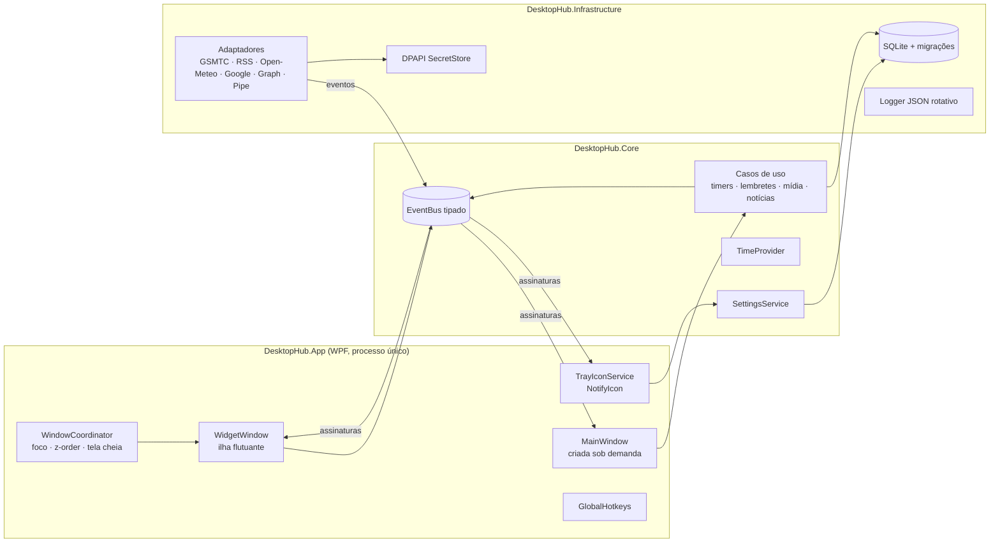
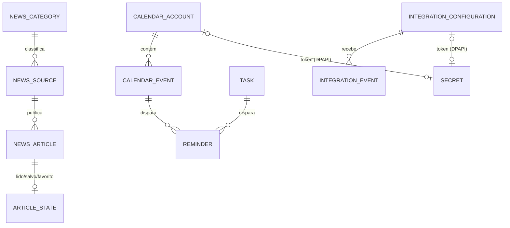

# Arquitetura — Personal Desktop Hub

> Documento vivo. Decisões pontuais e suas justificativas ficam em [DECISIONS.md](DECISIONS.md).

## 1. Entendimento do produto

Um **aplicativo residente** do Windows 11 que fica em execução o dia todo (inclusive durante jogos)
e expõe a mesma informação em três superfícies:

| Superfície | Papel | Custo esperado |
|---|---|---|
| **Bandeja** (Modo C) | Processo vivo, serviços em segundo plano, menu rápido | Mínimo — nenhuma árvore visual WPF ativa |
| **Widget flutuante** (Modo B) | "Ilha" compacta que muda de tamanho e conteúdo por estado | Baixo — uma janela pequena, renderiza só quando algo muda |
| **Aplicação completa** (Modo A) | Leitura, gestão e configuração | Maior — criada sob demanda e **destruída** ao fechar |

A regra que guia tudo: **os serviços vivem no processo, não nas janelas**. Fechar a janela principal
ou o widget nunca para temporizadores, lembretes ou sincronizações.

### Requisitos funcionais (resumo)
Notícias agregadas (RSS/APIs oficiais) · meteorologia · calendário local + sincronização opcional ·
lembretes e tarefas com notificações · controle universal de mídia por sessão · cronômetro,
temporizador e Pomodoro · eventos de ferramentas (Claude Code via hooks) · central de notificações ·
dashboard personalizável · configurações.

### Requisitos não funcionais
- CPU ~0% ocioso: **nenhum polling de alta frequência**; tudo orientado a eventos ou timers longos.
- Memória: a janela completa é descartável; o widget e a bandeja têm orçamento próprio (ver §9).
- Offline-first: SQLite local é a fonte da verdade para dados do usuário.
- Isolamento de falhas: uma integração que cai não derruba outra.
- Segurança: tokens protegidos por DPAPI, conteúdo remoto tratado como não confiável.
- Tempo correto: relógio de parede (UTC) para agendamentos, relógio monotônico para durações.

## 2. Estilo arquitetural: monólito modular com portas e adaptadores

Um único processo, um único executável. Dentro dele, módulos com fronteiras explícitas:

- **Core** (domínio + aplicação): entidades, regras, contratos (portas), eventos tipados, casos de uso.
  Não referencia WPF, SQLite nem Win32. É 100% testável em unidade.
- **Infrastructure**: adaptadores das portas — SQLite, migrações, logs, segredos (DPAPI), HTTP,
  e (a partir da Fase 2) APIs WinRT como `Windows.Media.Control`.
- **App** (apresentação + composição): WPF, bandeja, widget, interop Win32 de janelas,
  raiz de injeção de dependência.

Por que não Clean Architecture completa com 4+ camadas e projetos? Para uma aplicação desktop
pessoal, separar "Domain" de "Application" em projetos diferentes adiciona cerimônia sem ganho.
Elas são **pastas** dentro do Core, e a regra de dependência é verificada pelo grafo de projetos:

```
App ──► Infrastructure ──► Core
 └──────────────────────────►┘
Tests ──► (Core | Infrastructure)
```

Microsserviços, processos auxiliares e brokers externos estão **fora de escopo** (ADR-002).

## 3. Diagrama de componentes



### Fluxo de dados (exemplo: troca de faixa no Spotify — Fase 2)
1. O Windows dispara `MediaPropertiesChanged` na sessão GSMTC do Spotify.
2. O adaptador `GsmtcMediaSource` (Infrastructure) traduz para `MediaSessionChanged(snapshot)` — um
   registro imutável — e publica no `EventBus`.
3. O `MediaService` (Core) atualiza o estado de seleção (qual sessão o usuário escolheu) e republica
   `ActiveMediaChanged` apenas se a sessão afetada for a selecionada.
4. O `WidgetViewModel` está assinado com despacho para a thread de UI; atualiza propriedades;
   o WPF re-renderiza **só** os elementos alterados. Nenhum timer envolvido.

### Fluxo de comandos
UI → caso de uso (Core) → porta → adaptador. A UI nunca fala com SQLite ou WinRT diretamente.

## 4. Barramento de eventos

`IEventBus` (Core/Events) — em processo, síncrono por padrão, sem dependências externas.

- Eventos são `record`s imutáveis que implementam `IAppEvent` (contratos tipados).
- `Subscribe<T>(handler, SynchronizationContext? context)` devolve `IDisposable`. Com `context`,
  o handler é postado nessa thread (ex.: UI). Sem `context`, roda na thread do publicador.
- **Política de erros**: exceção em um assinante é registrada em log (tipo do evento + tipo do
  assinante) e **não** se propaga ao publicador nem impede os demais assinantes.
- Sem replay, sem filas persistentes: estado durável fica no SQLite; o bus só notifica mudanças.

Eventos planejados (catálogo em `src/DesktopHub.Core/Events/`):

| Evento | Publicador | Fase |
|---|---|---|
| `SettingsChanged` | SettingsService | 1 |
| `WidgetVisibilityChanged` | WidgetController | 1 |
| `ForegroundFullscreenChanged` | FullscreenMonitor | 1 |
| `MediaSessionsChanged` | GsmtcMediaSource | 2 ✅ |
| `ActiveMediaChanged` | MediaService | 2 ✅ |
| `MasterVolumeChanged` | CoreAudioMasterVolume | 2 ✅ |
| `OpenMainRequested` | widget, bandeja | 2 ✅ |
| `ProductivityChanged`, `TimerCompleted` | ProductivityService | 3 ✅ |
| `NotificationProcessed`, `NotificationActivated` | NotificationCenter | 3 ✅ |
| `AgendaChanged` | AgendaService (eventos, tarefas, categorias) | 4 ✅ |
| `RemindersChanged` | ReminderScheduler (entregue, adiado, dispensado) | 4 ✅ |
| `NewsUpdated`, `WeatherUpdated` | NewsService/WeatherService | 5 ✅ |
| `ActivityReceived` | ActivityService (canal local do Claude Code) | 6 ✅ |
| `CalendarSubscriptionsChanged` | CalendarSubscriptionService | 6 ✅ |

## 5. Tempo e agendamento

Usamos o `System.TimeProvider` do próprio .NET (sem abstração caseira; nos testes,
`FakeTimeProvider` permite avançar o tempo de forma determinística):

- `TimeProvider.GetUtcNow()` para tudo que é "quando" (lembretes, eventos, publicação de notícias).
- `TimeProvider.GetTimestamp()` / `GetElapsedTime()` (monotônico) para durações curtas.
- Temporizadores **não** contam ticks: guardam `startedAtUtc` + `accumulated`. O tempo exibido é
  calculado na hora de exibir. A UI só agenda um redesenho por segundo **enquanto visível**.
- Lembretes (Fase 4 ✅, ADR-018): um único `ReminderScheduler` dorme até o próximo aviso (timer do
  `TimeProvider`, no máximo 6 h) e é reavaliado em `SystemEvents.PowerModeChanged` (retomada),
  `TimeChanged` (também limpa o cache de fuso) e a cada `AgendaChanged`. Cada avaliação cobre o intervalo
  desde a última (marca d'água persistida): vencimentos perdidos com o app fechado ou o PC suspenso são
  entregues ao voltar, marcados como atrasados, e nunca repetidos.
- Recorrência (ADR-017): `RecurrenceExpander` gera inícios em horário de parede; `ZonedTime` converte para
  UTC com as regras de horário de verão do RFC 5545.

## 6. Janelas, foco e z-order (Windows)

| Necessidade | Mecanismo (documentado) |
|---|---|
| Não roubar foco | `WS_EX_NOACTIVATE` + `ShowActivated=false`; botões funcionam sem ativar |
| Fora do Alt+Tab e da barra | `WS_EX_TOOLWINDOW`, `ShowInTaskbar=false` |
| Sempre visível | `Topmost` (→ `HWND_TOPMOST`) configurável |
| Cantos e transparência | Janela em camadas do WPF (`AllowsTransparency`); pixels com alfa 0 não capturam clique |
| Opacidade | `Window.Opacity` (só possível em janela em camadas) |
| DPI | Manifesto `PerMonitorV2`; posição persistida em pixels físicos + validada contra `MonitorFromRect` |
| Multi-monitor | Posição restaurada é ajustada para a área de trabalho de um monitor existente |
| Jogos/tela cheia | `SetWinEventHook(EVENT_SYSTEM_FOREGROUND)` + comparação da janela em primeiro plano com o monitor; política configurável (ocultar/manter) |
| Capturas de tela | Opcional: `SetWindowDisplayAffinity(WDA_EXCLUDEFROMCAPTURE)` (Win10 2004+) |
| Teclado | Atalho global (`RegisterHotKey`) para mostrar/ocultar; foco explícito sob demanda |

Por que janela em camadas e não `DWMWA_WINDOW_CORNER_PREFERENCE`? Os cantos do DWM têm raio fixo
pequeno e não permitem opacidade; a ilha precisa de raio grande e transições de tamanho suaves. A
janela tem tamanho fixo de "tela de pintura" e **a ilha anima dentro dela** — evitando redimensionar
o HWND a cada quadro (fonte clássica de tremulação no WPF). Como a janela é pequena e só repinta em
mudanças, o custo da composição por software é baixo; isso será medido (ADR-004).

## 7. Persistência

SQLite (`Microsoft.Data.Sqlite`, sem ORM) em `%LOCALAPPDATA%\DesktopHub\hub.db`.

- WAL, `foreign_keys=ON`, `busy_timeout`.
- **Migrações versionadas** embutidas no código, aplicadas em transação, versão em `PRAGMA user_version`.
  Antes de migrar um banco existente, é feito backup (`VACUUM INTO`) em `backups/`.
- **Integridade**: `PRAGMA quick_check` na abertura. Falha ⇒ o arquivo é movido para
  `corrupt/hub-<timestamp>.db`, um banco novo é criado e o evento é registrado e exibido ao usuário.
- Segredos (tokens OAuth): tabela `secrets` com blobs cifrados por **DPAPI (CurrentUser)**.
- Logs: JSON Lines em `%LOCALAPPDATA%\DesktopHub\logs\`, rotação diária, retenção de 7 arquivos.

### Modelo de dados

Persistente (SQLite) vs. transitório (memória):

| Entidade | Onde | Observação |
|---|---|---|
| `UserPreferences`, `WidgetPreferences` | `settings` (chave → JSON) | seções versionadas, padrões em código |
| `NewsSource` | `news_sources` ✅ | curadas (ID estável derivado da URL) + do usuário; ETag, Last-Modified, falhas, próxima busca |
| `NewsArticle` | `news_articles` ✅, retenção configurável | `UNIQUE(source_id, item_key)`, `canonical_url`, `title_key`, `cluster_id`; lida/salva/favorita na própria linha (salvos e favoritos não expiram) |
| Clima | `cache` ✅ (`weather.last`) | última previsão em JSON, exibida offline |
| `CalendarAccount` | tabela | tokens **não** ficam aqui, só referência a `secrets` |
| `CalendarEvent` | `calendar_events` ✅ | início em horário de parede + `time_zone`, `rrule`, `exdates`, avisos; conta/`remote_id`/`etag` chegam com a sincronização (Fase 6) |
| `Task` | `tasks` ✅ | prazo opcional (com ou sem hora), prioridade, recorrência ancorada, aviso |
| `AgendaCategory` | `agenda_categories` ✅ | nome + cor; FK `ON DELETE SET NULL` |
| `Reminder` | calculado + `reminder_log` ✅ | registro por chave estável e marca d'água em `agenda_meta` (ADR-018) |
| `TimerSession`, `ProductivitySession` | tabelas | só sessões encerradas + sessão ativa para recuperação |
| `Notification` | tabela, retenção 30 dias | `dedup_key` para prevenir duplicatas |
| `IntegrationConfiguration` | tabela | habilitada/escopos/último sync/último erro |
| `IntegrationEvent` | tabela, retenção curta | histórico de eventos recebidos |
| `MediaSession` | **memória** | espelho do Windows; só a *preferência* de fonte é persistida |
| Estado de animação/visual do widget | **memória** | |



Identificadores: `TEXT` com GUID v7 (ordenável por tempo) gerado no app — permite criar
offline e sincronizar sem colisão. Datas: `INTEGER` em milissegundos Unix UTC + `tzid` quando o
fuso original importa (eventos de calendário). A Fase 1 cria apenas `settings` e `secrets`
(logs ficam em arquivo); cada fase adiciona sua migração em `Persistence/Migrations.cs`.

## 8. Integrações — o que é possível de verdade

| Área | Mecanismo oficial | Limitações conhecidas |
|---|---|---|
| Mídia local ✅ | `Windows.Media.Control.GlobalSystemMediaTransportControlsSessionManager` (WinRT) — lista sessões, metadados, capa, estado, linha do tempo, play/pause/próxima/anterior/seek, eventos de mudança | Depende do app expor SMTC. Navegadores Chromium (Brave/Chrome/Edge) tendem a expor **uma sessão por navegador**, só enquanto há mídia numa aba. Linha do tempo e capa variam por app. **Não controla volume.** Verificado: Spotify desktop aparece como `Spotify.exe`, e `AppInfo.GetFromAppUserModelId` falha para ele (app Win32) — nome amigável vem de heurística. Objetos devem ser usados no MTA (ADR-010). |
| Volume geral ✅ | Core Audio `IAudioEndpointVolume` + `IMMNotificationClient` | Volume do dispositivo padrão; troca de dispositivo acompanhada. |
| Volume por app | Core Audio (`IAudioSessionManager2`, `ISimpleAudioVolume`) via COM | Associação sessão de mídia → sessão de áudio é por processo (heurística via AUMID/PID). Global: `IAudioEndpointVolume`. |
| Spotify (complementar) | Web API com OAuth Authorization Code + PKCE | **Comandos de reprodução exigem Premium.** Apps em modo de desenvolvimento têm limite de usuários. Opcional e claramente separado do controle local. |
| Clima | Open-Meteo (sem chave, atual/horária/diária, UV, prob. de chuva) | Uso não comercial, atribuição CC BY 4.0. **Não fornece alertas oficiais**; alertas do INMET a investigar na Fase 5 (feeds RSS/CAP). |
| Notícias | RSS/Atom dos veículos; Atom de releases do GitHub (`/releases.atom`); APIs NVD/CISA KEV (vulnerabilidades); Steam `ISteamNews/GetNewsForApp` | Cada fonte tem termos próprios; **sem scraping**. NewsAPI e similares têm planos gratuitos restritos a desenvolvimento. |
| Google Calendar | Calendar API v3, OAuth 2.0 "installed app" com redirect loopback + PKCE, sync incremental por `syncToken` | Requer projeto no Google Cloud com tela de consentimento; o usuário traz o próprio client ID. |
| Outlook | Microsoft Graph (`calendarView`, consultas delta) com MSAL.NET | Registro de app no Entra ID. |
| ICS | Download HTTP + parser RFC 5545 (Ical.Net) | Somente leitura. |
| Notificações ✅ | Toasts do Windows com AUMID próprio registrado em `HKCU\Software\Classes\AppUserModelId` (ADR-015) | Sem ativador COM, toast antigo não reabre o app fechado. O Windows aplica "Não incomodar"; a política do app trata pausa, silêncio e tela cheia (ADR-016). |
| Claude Code ✅ | **Hooks** oficiais em `~/.claude/settings.json` (`SessionStart`, `UserPromptSubmit`, `Notification`, `Stop`, `SessionEnd`) executam `DiaryGhost.exe --hook claude-code`, que recebe o JSON pela entrada padrão | Reduz ao contrato v1 e repassa por **named pipe** restrito ao usuário (ADR-023). Conversas do Claude no navegador/app desktop **não** têm API de observação — fora de escopo. |
| Agendas Google/Outlook ✅ | Assinatura do endereço iCal (somente leitura) | Sem OAuth (ADR-024); endereço cifrado com DPAPI. |
| Outras ferramentas | Mesmo pipe local com contrato JSON versionado (`IntegrationEventReceived`) | Qualquer ferramenta que execute um comando ao concluir (CI local, scripts, builds) pode emitir eventos. |

## 9. Desempenho — orçamento e método

Metas **a validar com medição**, não promessas:

- Ocioso (só bandeja): CPU ≈ 0%; nenhum timer < 1 s ativo.
- Widget visível parado: nenhum quadro renderizado entre mudanças de estado.
- Janela principal: liberada ao fechar (`Close` destrói a árvore visual; não é apenas ocultada).

Técnicas: inicialização preguiçosa de módulos, `ReadyToRun` na publicação, timers de UI parados
quando a janela não está visível, HTTP com `ETag/If-Modified-Since`, backoff exponencial com jitter,
limite de concorrência por integração.

Medição: `scripts/measure.ps1` amostra *working set*, *private bytes* e tempo de CPU do processo nos
três modos. Resultados versionados em `docs/benchmarks/`.

**Medido na Fase 1** ([detalhes](docs/benchmarks/2026-11-06-fase1.md)): CPU 0 ms em 30 s nos três modos;
memória privada de 50 MB (bandeja), 71 MB (widget) e 71 MB (janela principal); inicialização ~0,8 s.

## 10. Segurança

- Integrações são opt-in; cada uma declara escopos.
- Nenhuma senha de conta é solicitada: OAuth no navegador do sistema.
- Tokens: DPAPI; nunca em logs (o logger não serializa objetos arbitrários, só campos explícitos).
- URLs externas: apenas `http`/`https` são abertas, via `ShellExecute` do navegador padrão.
- HTML de notícias nunca é renderizado como HTML ativo: é convertido para texto. Sem WebView.
- Conteúdo remoto nunca é interpretado como comando — inclusive se houver resumo por IA (o texto
  da notícia entra como dado, nunca como instrução).
- Pipe local aceita apenas o usuário atual (ACL do named pipe) e valida o JSON contra o contrato.

## 11. Estrutura do repositório

```
DesktopHub.slnx
Directory.Build.props          # configurações comuns (nullable, warnings, versão)
assets/                        # ícone
scripts/                       # build, publicação, medição, geração de ícone
src/
  DesktopHub.Core/             # domínio + aplicação (sem dependências de plataforma)
    Events/                    # IAppEvent, EventBus, catálogo de eventos
    Settings/                  # modelos de preferências, ISettingsStore, SettingsService
    Security/                  # ISecretStore
    Windowing/                 # lógica pura de posicionamento (multi-monitor)
  DesktopHub.Infrastructure/
    Persistence/               # SqliteDatabase, Migrator, migrações
    Settings/                  # SqliteSettingsStore
    Security/                  # DpapiSecretStore
    Logging/                   # JsonFileLoggerProvider
  DesktopHub.App/              # WPF
    Platform/                  # interop Win32 (estilos de janela, monitores, hotkeys, autostart)
    Shell/                     # bandeja, instância única, coordenação de janelas
    Widget/                    # janela e view-model da ilha
    Main/                      # janela principal e páginas
    Theme/                     # tokens de cor, estilos
tests/
  DesktopHub.Core.Tests/
  DesktopHub.Infrastructure.Tests/
```
