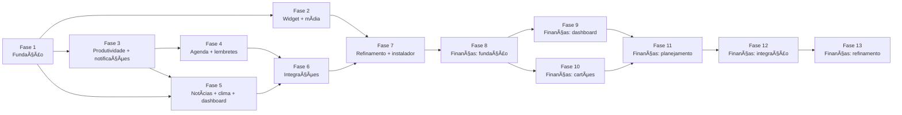

# Roadmap

Cada fase termina com um executável utilizável, testes passando e um benchmark registrado em
`docs/benchmarks/`. Um controle só conta como pronto quando executa a operação real — ou diz
explicitamente que depende de configuração.

Fases 2 e 3 são independentes entre si; a 3 vem antes da 4 porque a central de notificações nasce nela.

---

## Fase 1 — Fundação ✅ (2026-11-06)
Entregue: solução, arquitetura, SQLite com migrações/backup/recuperação de corrupção, configurações
persistentes, logs estruturados, segredos DPAPI, janela principal com navegação, bandeja, widget
flutuante (compacto/expandido, arrastar, posição memorizada e validada em multi-monitor, sempre
visível, bloqueio, opacidade, sem roubar foco, oculto em tela cheia, exclusão de capturas),
atalhos globais, instância única, `--quit`, inicialização com o Windows, 28 testes, benchmark.

Critérios de aceitação do MVP atendidos nesta fase: 2, 3, 4, 5\*, 13, 14, 15.
\* Mover entre monitores: lógica testada; validação manual com dois monitores pendente.

## Fase 2 — Widget e mídia ✅ (2026-11-06)
Entregue:
- Adaptador `GsmtcMediaSource` (`Windows.Media.Control`): sessões, metadados, capa (≤ 4 MB), estado,
  linha do tempo, comandos; orientado a eventos, com debounce e sem republicar o que não mudou.
- `MediaService` + `MediaSelection`: seleção explícita (chips), fonte preferencial, histerese no automático
  (ADR-009), comandos só para a sessão exibida, apenas comandos suportados.
- Volume geral do Windows via Core Audio, acompanhando mudanças externas e troca de dispositivo.
- Widget redesenhado a partir do vídeo (`docs/VIDEO-ANALYSIS.md`): cabeçalho, abas na base, painéis
  Início / Mídia / Volume reais; Foco, Agenda e Atividade indicam a fase.
- Página Mídia na janela principal, submenu de mídia na bandeja, cartão "Em reprodução" no dashboard.
- Ilha acionável por UI Automation (leitores de tela), log de causas de mudança de layout,
  arquivo `crash.log` síncrono para falhas fatais.
- 52 testes (24 novos, quase todos de mídia, incluindo a regressão do ADR-009); benchmark com mídia tocando.

Critérios do MVP: **6 ✅** (controlar sessão real: pausar, retomar e avançar no Spotify verificados).
**7 ⚠️ parcial**: a troca entre sessões está implementada e testada em unidade, e foi exercitada ao vivo com
duas sessões, mas não houve um teste controlado Spotify + Brave lado a lado (o Brave não estava tocando).

Pendências levadas adiante:
- Teste manual Spotify + Brave (ver "Como testar" no README).
- Volume por app (ADR-012).
- Navegação por teclado dentro do widget expandido (hoje: UI Automation sim, foco por teclado não).
- Investigar com profiler o custo residual do painel Mídia (benchmark da Fase 2).
- Botão "abrir no app" da fonte.

## Identidade (entre as fases 2 e 3) ✅
Nome **Diary Ghost** e logo original do fantasminha (ADR-013).

## Fase 3 — Produtividade e notificações ✅ (2026-11-06)
Entregue:
- Cronômetro (voltas), temporizador (presets 5/10/15/25/30/60 e minutos livres), Pomodoro (durações,
  ciclos, início automático opcional, histórico, estatísticas de hoje e 7 dias).
- Modelo de tempo por timestamps UTC, um único timer, reagendamento ao retomar da suspensão (ADR-014);
  estado salvo a cada mudança e retomado ao reiniciar; prazos vencidos com o app fechado concluídos como
  "atrasados".
- Central de notificações (ADR-016) e toasts nativos com botões (ADR-015).
- Widget: painel Foco (anel, status, ciclos, controles), cartão Foco real no Início, compacto mostra o
  timer em andamento. Página Produtividade. Notificações em Configurações. Bandeja: Pomodoro, cronômetro,
  pausar notificações.
- 88 testes (30 novos de tempo, notificação e persistência).

Critérios do MVP: **8 ✅** (cronômetro) e **9 ✅** (temporizador com notificação — verificado ao vivo, inclusive
com o app fechado durante o prazo).

Verificado ao vivo: toast na Central de Notificações com botão; recuperação após fechar o app.
**Não verificado ao vivo:** suspensão/hibernação real do PC (coberto pelos testes de prazo vencido e pelo
reagendamento em `Resume`); clique nos botões do toast (coberto por teste com sink falso).

Pendências levadas adiante:
- Custo de redesenho do widget expandido (benchmark da Fase 3) → Fase 7.
- Reabrir o app a partir de um toast antigo (precisa de ativador COM) → Fase 7, junto do instalador.

## Fase 4 — Agenda e lembretes ✅ (2026-11-06)
Entregue:
- Calendário local: visões **dia e semana** (grade de horas, eventos sobrepostos lado a lado, linha do
  "agora"), **mês** e **lista** (60 dias); criar com clique duplo num horário/dia; editor em gaveta.
- Eventos: dia inteiro ou com horário (inclusive atravessando a meia-noite), recorrência com presets
  (todo dia, dias úteis, semanal, quinzenal, mensal no dia / na Nª semana / última semana / último dia,
  anual) ou RRULE personalizado, término por vezes ou data, até 2 avisos, local, notas, categoria.
  Séries: editar a série inteira ou **só esta ocorrência**; excluir só esta / esta e as próximas / tudo.
- Recorrência própria (subconjunto do RFC 5545) com horário de parede + fuso (ADR-017).
- Tarefas: criação rápida, prazo com ou sem hora, prioridade, categoria, aviso, recorrência (concluir
  avança para a próxima data, sem empilhar atrasadas), filtros, grupos por prazo, adiar/reagendar.
- Lembretes: página com criação rápida ("daqui a 5 min", "às 15:30"), próximos 7 dias e histórico com o
  resultado de cada aviso. Toast com **adiar 5/10/30/60** (lista de escolha) e **concluir** (ADR-019).
- `ReminderScheduler` com chave estável e marca d'água (ADR-018). Categorias com cores (Configurações).
- Widget: painel **Agenda** (em andamento/próximos de hoje e amanhã, tarefas de hoje com concluir).
  Dashboard: "Próximo compromisso" e "Tarefas pendentes" com dados reais.
- Migração de banco 3; 139 testes (51 novos).

Aceite: **lembrete sobrevive a reinício e dispara ✅** (teste + verificado ao vivo: entregue às 16:30:00);
**vencimento perdido é entregue ao voltar como "atrasado" ✅** (teste + verificado ao vivo fechando o app
durante o horário do aviso); **recorrência com DST, fim de mês e exceções ✅** (testes).

**Não verificado ao vivo:** suspensão real do PC (mesmo caminho do app fechado + `Resume`); clicar em
"Adiar"/"Concluir" no toast (coberto por testes com sink falso; a lista de escolha depende do Windows).

Pendências levadas adiante:
- Arrastar eventos na grade para mudar horário/duração.
- ~~Importar/exportar `.ics`~~ → entregue na Fase 6.
- Toast antigo que reabre o app fechado (ativador COM) → Fase 7.

## Fase 5 — Informações ✅ (2026-11-06)
Entregue:
- **Notícias** só de feeds oficiais curados (24 fontes em 6 categorias, critérios em `docs/NEWS-SOURCES.md`,
  ADR-020), desligadas até o usuário ativar. GET condicional (ETag/If-Modified-Since), recuo exponencial,
  Retry-After, intervalo mínimo e limite de itens por fonte, retenção configurável.
- Parser RSS 0.9x/2.0, RSS 1.0 e Atom sem DTD/entidades externas; HTML → texto; links só http(s).
- Deduplicação por URL canônica e título normalizado; agrupamento por acontecimento (ADR-021).
- Página Notícias: categorias, Seguindo, Salvas, Favoritas, busca, só não lidas, marcar como lidas; cartões
  com fonte, autor, publicação e consulta; "Também em"; fontes (ocultar, adicionar validando, remover),
  assuntos seguidos com aviso opcional, intervalo e retenção.
- **Clima** Open-Meteo com cidade escolhida pelo nome (ADR-022): atual, hoje e 6 dias; última previsão
  guardada e exibida offline com o horário; temperatura no cabeçalho do widget.
- **Dashboard** com dados reais em todos os cartões; reordenar, largura normal/larga, ocultar e restaurar.
- Migração 4; 179 testes (40 novos).

Aceite: **notícias reais com fonte e horários de publicação e de consulta ✅** (verificado ao vivo: 1.152
artigos de 24 fontes); **clima real ✅** (verificado ao vivo); **offline mostra o último horário ✅** (teste;
o cartão exibe "Sem atualização recente — dados de … às …").

**Não verificado ao vivo:** comportamento com a rede desligada (coberto por testes); aviso de assunto seguido.

Pendências levadas adiante:
- Alertas meteorológicos oficiais (INMET/Defesa Civil) se surgir fonte pública documentada.
- Localização automática com consentimento.
- Arrastar cartões do dashboard (hoje: botões, acessíveis por teclado).

## Fase 6 — Integrações ✅ (2026-11-07)
Entregue:
- **Claude Code** pelos hooks oficiais (ADR-023): o próprio `DiaryGhost.exe --hook claude-code` (sem abrir
  interface) reduz o JSON do hook ao contrato v1 — evento, nome da pasta, ID curto da sessão, texto do
  aviso; prompts, transcrição e caminhos nunca saem — e entrega por named pipe restrito ao usuário
  (`CurrentUserOnly`). Instalação dos hooks por clique, com confirmação, backup e preservação do resto do
  `settings.json`; configuração manual exibida para copiar. Avisos de "resposta pronta" e "aguardando você",
  limite de 60 eventos/min, histórico de 7 dias.
- Painel **Atividade** no widget e cartão do Início com o estado das sessões.
- **Agendas do Google/Outlook por assinatura iCal** (ADR-024): sem login; endereço secreto cifrado com
  DPAPI; somente leitura; sincronização a cada 30 min com GET condicional; IDs estáveis (avisos não se
  repetem); categoria e aviso por agenda.
- **iCalendar**: leitor (TZID IANA/Windows, UTC, dia inteiro, DURATION, RRULE, EXDATE, RECURRENCE-ID,
  cancelados) e exportador (dobra de linhas, UNTIL em UTC, VALARM); importar `.ics` como eventos locais.
- Página **Atividades e integrações**. Migração 5. 202 testes (23 novos).

Verificado ao vivo: evento de teste e hooks simulados (JSON real de hook na entrada padrão) chegando à
página; assinatura da agenda pública de feriados do Google (Finados, Proclamação, Consciência Negra no mês).
Ocioso com o canal escutando: 0 ms de CPU / 30 s, 58 MB privados.
**Não verificado ao vivo:** instalação dos hooks no seu `~/.claude/settings.json` (testada em arquivos
temporários; não alterei o seu arquivo) e uma sessão real do Claude Code disparando os hooks.

Não entregue (ADR-024):
- OAuth com Google Calendar / Microsoft Graph (duas vias, conflitos) e Spotify Web API: exigem registrar o
  app no console de cada empresa para obter um *client ID*. A arquitetura (portas, `ISecretStore` com DPAPI)
  está pronta para recebê-los.

## Fase 7 — Refinamento ✅ (2026-11-07)
Entregue:
- **Instalação por usuário** (ADR-025): `DiaryGhost.exe --install` copia para `%LOCALAPPDATA%\Programs\DiaryGhost`,
  cria o atalho no Menu Iniciar e a entrada em "Aplicativos instalados"; rodar de novo atualiza no lugar.
  **Desinstalação limpa** (`--uninstall`, também pelo Windows): programa, atalho, inicialização com o Windows,
  registro de notificações, protocolo e os hooks do Claude Code instalados pelo app; os dados só são
  apagados se o usuário escolher. `scripts/publish.ps1` gera também um `.zip` para distribuir.
- **Notificação antiga reabre o app** (ADR-026): o clique no corpo do toast abre `diaryghost:<página>`,
  registrado no Windows; funciona com o app fechado. Links só navegam (lista fixa de páginas), nunca agem.
  Segunda execução repassa a página à instância aberta.
- **Acessibilidade:** `scripts/a11y-audit.ps1` (UI Automation, 9 páginas, 204 controles: todos com nome e
  foco por teclado — corrigidos os botões internos do controle deslizante); teste de contraste WCAG lendo
  `Tokens.xaml` (corrigido o cinza terciário de 3,6:1 para ≥ 4,5:1); tamanho do texto 100/115/130%.
- 220 testes (18 novos).

Verificado ao vivo: abrir por `diaryghost:tasks`, repassar `diaryghost:reminders` à instância aberta (um
só processo), link inválido ignorado; escala de texto; auditoria sem problemas.
**Não verificado ao vivo:** `--install`/`--uninstall` reais (testados com pasta e chave de registro
temporárias — não instalei nada no seu Windows); clique num toast real com o app fechado.

Não entregue (ADR-027):
- **Assinatura de código** (exige certificado de uma autoridade; sem ela o SmartScreen avisa e o Smart App
  Control pode bloquear o executável baixado).
- **Atualização automática** (sem servidor de distribuição; atualizar = rodar `--install` da versão nova).
- **Widget expandido com renderização por GPU** e **i18n** (só pt-BR).

---

# Diary Ghost Finance

Módulo de finanças pessoais local-first. A proposta completa (análise da referência, arquitetura, modelo de
dados e regras de contabilização, interface, segurança e testes) está em [docs/FINANCE.md](docs/FINANCE.md).
Proposta aprovada em 2026-11-11.

## Fase 8 — Fundação financeira ✅ (2026-11-11)
Entregue:
- `Money` (centavos em `long`, aritmética verificada, leitura de "1.234,56"/"1234.56", formatação pt-BR, rateio
  com o resto na 1ª parte), `finance.db` com migração própria, backup e quarentena (ADR-028).
- Contas (6 tipos, moeda, cor, saldo inicial com data, disponível ou não, arquivar), categorias padrão com
  subcategorias (um nível), receitas, despesas, transferências (soma zero), estornos ligados à despesa, ajustes
  de saldo (categoria de sistema), confirmados ou pendentes, etiquetas, forma de pagamento.
- Saldos derivados; resumo do mês (saldo em contas, patrimônio, receitas, despesas, resultado), filtros e busca,
  duplicar, excluir com desfazer, modo privacidade.
- 275 testes (55 novos: dinheiro, invariantes contábeis, validações, persistência, restrições do banco,
  atomicidade, logs sem valores, módulo sem rede).

Critérios do MVP financeiro: **1 ✅** (conta), **2 ✅** (receitas e despesas), **3 ✅** (saldo e histórico),
**4 ✅** (categorias personalizadas), **13 ✅** (fechar e reabrir sem perder dados), **14 ✅** (sem internet: o
módulo não usa a rede).

Verificado ao vivo (instância isolada): 2 contas, receita, despesa com subcategoria e etiquetas, despesa
pendente futura, transferência e estorno criados pela interface; saldos conferidos à mão (9.187,53 → 9.200,00
após estorno de 12,47; 11.000,00 na poupança); transferência fora de receitas e despesas; busca por etiqueta;
excluir e desfazer; modo privacidade; fechar e reabrir com tudo preservado; auditoria de acessibilidade (240
controles na varredura padrão + 56 com dados e editor aberto, todos com nome).

Pendências levadas adiante:
- Painel lateral de edição divide a largura com a lista; em janelas pequenas a lista fica baixa (rolável).
- Desempenho com 50 mil lançamentos (meta definida na proposta) → Fase 13.

## Fase 9 — Dashboard financeiro ✅ (2026-11-11)
Entregue:
- `FinanceMetrics`: visão do mês com data de corte (hoje, ou o último dia de um mês passado); **saldo previsto
  decomposto de forma exata** (saldo hoje + a receber − a pagar ± transferências/ajustes = previsto, com teste);
  patrimônio; pendentes atrasados; comparação com o mês anterior (omitida quando nenhuma conta existia nele);
  receitas × despesas por mês; gasto por categoria principal somando subcategorias e descontando estornos; saldo
  do disponível dia a dia (confirmado até hoje, previsto depois); pendentes até o fim do mês.
- Aba **Visão geral** (padrão da página): cartão do saldo previsto com barra segmentada e equação, pendentes,
  4 indicadores com ▲▼ e % vs. mês anterior, gráficos de receitas × despesas (6 meses), gastos por categoria
  (barras horizontais) e saldo ao longo do mês (linha contínua/tracejada) com os pontos-chave em texto.
  "Ver como tabela" troca todos os gráficos por tabelas. Cada cartão traz a definição do número (dica e texto de
  ajuda para leitores de tela). Layout em colunas ou empilhado conforme a largura.
- **Modo privacidade salvo** nas configurações (vale para a página e o dashboard, entre sessões).
- Cartão **Finanças** no Dashboard principal: oculto por padrão (valores financeiros só aparecem por escolha em
  "Personalizar"); saldo, previsto, despesas do mês, próximos pendentes; respeita o modo privacidade.
- 285 testes (10 novos, com um cenário de novembro calculado à mão).

Critério do MVP financeiro: **8 ✅** (dashboard com valores calculados corretamente).

Verificado ao vivo (mesma instância de teste da Fase 8): previsto 18.400,00 = 20.200,00 − 1.800,00 (aluguel
pendente); gastos Moradia 1.800,00 (86%) e Alimentação 300,00 (14%, já com o estorno); saldo dia a dia
12.500,00 → 20.500,00 (salário) → 20.187,53 (mercado) → 20.200,00 (estorno) → 18.400,00 previsto; tabela com os
mesmos números; cartão no Dashboard e "Abrir Finanças"; modo privacidade persistindo após reiniciar e mascarando
o Dashboard; auditoria de acessibilidade sem problemas; 0 ms de CPU em 30 s com a Visão geral aberta.

Pendências levadas adiante:
- Faturas de cartão ainda não entram no previsto nem no patrimônio → Fase 10.
- "Reservado" (metas) ainda não existe; o disponível é igual ao saldo em contas → Fase 11.

| Fase | Entrega | Critérios do MVP financeiro |
|---|---|---|
| 8 — Fundação (A) ✅ | `Money` em centavos, `finance.db`, contas, categorias, lançamentos, transferências, ajustes, saldos derivados, página Lançamentos | 1, 2, 3, 4, 13, 14 |
| 9 — Dashboard (B) ✅ | indicadores com definição formal, Visão geral por mês, gráficos, comparação mensal, modo privacidade, cartões no dashboard | 8 |
| 10 — Cartões (C) | ciclos com vigência, compras, parcelas, faturas, limite, pagamentos totais e parciais, estornos | 5, 6, 7 |
| 11 — Planejamento (D) | orçamentos, recorrências, contas e assinaturas, metas (real × planejado), projeções e simulador | 9, 10 |
| 12 — Integração (E) | lembretes, sobreposição no calendário, painel do widget (valores ocultos), importação CSV/OFX | 11, 12 |
| 13 — Refinamento (F) | relatórios e CSV, anexos, backup cifrado, avaliação de cifragem e Windows Hello, desempenho, acessibilidade | — |
