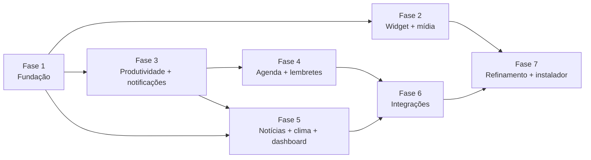

# Roadmap

Cada fase termina com um executável utilizável, testes passando e um benchmark registrado em
`docs/benchmarks/`. Um controle só conta como pronto quando executa a operação real — ou diz
explicitamente que depende de configuração.

Fases 2 e 3 são independentes entre si; a 3 vem antes da 4 porque a central de notificações nasce nela.

---

## Fase 1 — Fundação ✅ (2026-11-06)
Entregue: solução, arquitetura, SQLite com migrações/backup/recuperação de corrupção, configurações
persistentes, logs estruturados, segredos DPAPI, janela principal com navegação, bandeja, widget
flutuante (compacto/expandido, arrastar, posição memorizada e validada em multi-monitor, sempre
visível, bloqueio, opacidade, sem roubar foco, oculto em tela cheia, exclusão de capturas),
atalhos globais, instância única, `--quit`, inicialização com o Windows, 28 testes, benchmark.

Critérios de aceitação do MVP atendidos nesta fase: 2, 3, 4, 5\*, 13, 14, 15.
\* Mover entre monitores: lógica testada; validação manual com dois monitores pendente.

## Fase 2 — Widget e mídia ✅ (2026-11-06)
Entregue:
- Adaptador `GsmtcMediaSource` (`Windows.Media.Control`): sessões, metadados, capa (≤ 4 MB), estado,
  linha do tempo, comandos; orientado a eventos, com debounce e sem republicar o que não mudou.
- `MediaService` + `MediaSelection`: seleção explícita (chips), fonte preferencial, histerese no automático
  (ADR-009), comandos só para a sessão exibida, apenas comandos suportados.
- Volume geral do Windows via Core Audio, acompanhando mudanças externas e troca de dispositivo.
- Widget redesenhado a partir do vídeo (`docs/VIDEO-ANALYSIS.md`): cabeçalho, abas na base, painéis
  Início / Mídia / Volume reais; Foco, Agenda e Atividade indicam a fase.
- Página Mídia na janela principal, submenu de mídia na bandeja, cartão "Em reprodução" no dashboard.
- Ilha acionável por UI Automation (leitores de tela), log de causas de mudança de layout,
  arquivo `crash.log` síncrono para falhas fatais.
- 52 testes (24 novos, quase todos de mídia, incluindo a regressão do ADR-009); benchmark com mídia tocando.

Critérios do MVP: **6 ✅** (controlar sessão real: pausar, retomar e avançar no Spotify verificados).
**7 ⚠️ parcial**: a troca entre sessões está implementada e testada em unidade, e foi exercitada ao vivo com
duas sessões, mas não houve um teste controlado Spotify + Brave lado a lado (o Brave não estava tocando).

Pendências levadas adiante:
- Teste manual Spotify + Brave (ver "Como testar" no README).
- Volume por app (ADR-012).
- Navegação por teclado dentro do widget expandido (hoje: UI Automation sim, foco por teclado não).
- Investigar com profiler o custo residual do painel Mídia (benchmark da Fase 2).
- Botão "abrir no app" da fonte.

## Fase 3 — Produtividade e notificações
- Cronômetro (voltas), temporizador (presets 5/10/15/25/30/60), Pomodoro (ciclos, histórico, estatísticas).
- Cálculo por timestamps (`TimeProvider`), recuperação após suspensão/reinício (`timer_sessions`).
- Central de notificações: prioridades, horário de silêncio, modo foco, deduplicação, histórico,
  respeito ao "Não incomodar" e a jogos em tela cheia. ADR de toasts.
- **Aceite:** temporizador de 25 min notifica com app minimizado; suspender a máquina no meio não gera
  deriva; testes com `FakeTimeProvider`.

## Fase 4 — Agenda e lembretes
- Calendário local (dia/semana/mês/lista), eventos recorrentes (RRULE) com fuso, categorias e cores.
- Tarefas e lembretes com prioridade, recorrência, adiar 5/10/30/60, reagendar.
- `ReminderScheduler` que dorme até o próximo vencimento; reavalia em retomada/mudança de horário.
- **Aceite:** lembrete criado sobrevive a reinício e dispara; vencimento perdido durante suspensão é
  entregue ao retomar como "atrasado"; testes de recorrência (DST, fim de mês, exceções).

## Fase 5 — Informações
- Fontes RSS/Atom curadas + do usuário, ETag/If-Modified-Since, backoff, limites por fonte.
- Deduplicação (URL canônica + título normalizado) e agrupamento por acontecimento.
- Leitor: salvar, favoritar, lida, busca, filtros, seguir assuntos, ocultar fontes; HTML convertido em texto.
- Clima Open-Meteo (localização manual; automática só com consentimento); investigar alertas INMET.
- Dashboard com cartões reorganizáveis e redimensionáveis.
- **Aceite:** lista de notícias reais com fonte e horários de publicação e de consulta; clima real;
  offline mostra o último horário de atualização.

## Fase 6 — Integrações
- Google Calendar e Outlook (OAuth no navegador do sistema, PKCE, sync incremental, conflitos).
- Spotify Web API opcional (claramente separada do controle local; avisa sobre exigência de Premium).
- `hub-notify` + named pipe para Claude Code (hooks) e outras ferramentas; página de estado das integrações.

## Fase 7 — Refinamento
- Instalador, atalhos, desinstalação limpa, atualizações (ADR), assinatura de código.
- Acessibilidade (auditoria com Narrador, contraste, tamanho de fonte), i18n.
- Otimização guiada pelos benchmarks; testes de UI.

## Ideias futuras (não comprometidas)
Paleta de comandos e busca global · atalhos personalizáveis · resumo diário · IA opcional para resumos
(conteúdo externo tratado sempre como dado) · GitHub · Steam · perfis · exportar/importar · plugins.
