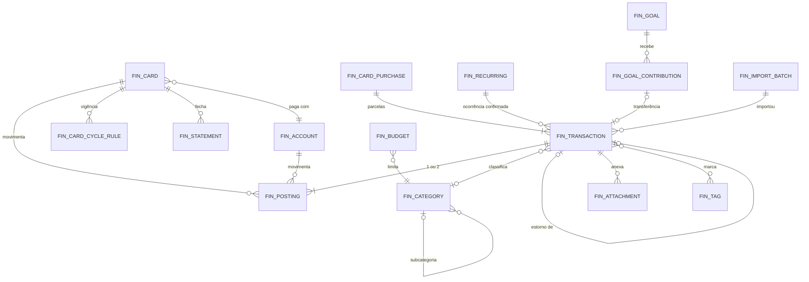

# Diary Ghost Finance — proposta e andamento

Módulo de finanças pessoais, local-first, dentro do Diary Ghost. Este documento traz a proposta aprovada:
análise da referência, arquitetura, modelo de dados e regras de contabilização, interface, segurança,
roadmap e critérios de teste.

> **Andamento.** A **Fase 8 (fundação)** está implementada: `Money`, `finance.db` (migração 1), contas,
> categorias, receitas, despesas, transferências, estornos, ajustes, saldos derivados, filtros, busca, resumo do
> mês e modo privacidade. Diferenças em relação à proposta: as etiquetas ficam numa coluna `tags` (texto) em
> `fin_transactions`, não em tabelas próprias (a busca é em memória; tabelas voltam se houver filtro por
> etiqueta no banco); `fin_postings.card_id` já existe, sem chave estrangeira até a Fase 10 criar os cartões.
> A **Fase 9 (dashboard)** também: indicadores da seção 3.4 que já têm dados (saldo em contas, previsto
> decomposto, receitas e despesas confirmadas/pendentes, patrimônio, comparação mensal), Visão geral com gráficos
> e tabelas, modo privacidade salvo e cartão opcional no Dashboard.
> A **Fase 10 (cartões)** também, com três ajustes em relação à seção 3.3, registrados no ADR-032:
> (1) a parcela k tem competência na data da compra + (k−1) meses (não no mês da fatura), que é como o usuário
> lembra do gasto; (2) uma troca de fechamento/vencimento vale a partir do mês seguinte ao da fatura aberta, para
> cada mês ter um único fechamento (o ciclo de transição fica mais curto ou mais longo); (3) o saldo de uma fatura só
> passa para a seguinte depois do vencimento — antes disso ela ainda vai ser paga. Sem compras com outras taxas:
> o app não calcula juros. A **Fase 11 (planejamento)** também, com os ajustes do ADR-033: recorrências com modelo próprio (dia 29–31
> cai no último dia do mês; não reusa o RRULE da Agenda), orçamento pela mesma competência da Fase 10 (parcela na data
> da parcela) e Visão geral redesenhada em grade de cartões a partir de uma nova referência visual do usuário.
> A **Fase 12 (integração)** também (ADR-034): avisos de vencimento pelo agendador de lembretes (nova porta
> `IReminderSource`), vencimentos sobrepostos no calendário (`ICalendarOverlaySource`), painel do widget com valores
> ocultos e importação de extratos OFX/CSV (só contas; importar fatura de cartão fica para depois). As demais seções
> A **Fase 13 (refinamento)** também (ADR-035): relatórios, exportação CSV, regras de categorização, backup protegido
> por senha e teste de desempenho com 50 mil lançamentos; anexos, PDF, banco cifrado e Windows Hello ficaram para depois.
> **Modo simples (ADR-036):** a página foi reorganizada como a planilha do usuário (Mês, Contas e cartões, Assinaturas,
> Metas e "Mais"); a seção 4 abaixo descreve a proposta original de telas.
> descrevem o que vem nas próximas fases.

> **Nomes.** A especificação fala em "Orbit" e "Orbit Learn". Este repositório é o **Diary Ghost**, e não há
> módulo "Learn" nele. O módulo se chama **Finanças** na navegação e **Diary Ghost Finance** nos documentos.
> Se "Orbit" for um novo nome para o app, a troca é só de textos e não muda nada abaixo.

---

## 1. Análise da referência visual

**O que funciona e vamos manter:**
- **Um número-herói com explicação.** "Saldo previsto" grande, e logo abaixo uma barra segmentada que
  decompõe o valor (salário − metade da casa − contas pessoais − dia a dia = sobra), com legenda e percentuais.
  O usuário entende *de onde* vem o número. Essa é a ideia mais valiosa da imagem.
- **Contas a pagar com seletor de dias** (05, 08, 10, 12, 15): mostra a semana de vencimentos sem calendário.
- **Cartões com linha do tempo das faturas** (dez → jan → fev): mostra o peso das parcelas futuras.
- **Barras de progresso com marca de referência** (Moradia: 20% do salário com marca em 30%).
- **Mês no cabeçalho com ‹ ›** e um botão primário "+ Adicionar" com menu.
- **Grade de cartões** de tamanhos diferentes, com hierarquia clara: título, valor, detalhe.

**O que não vamos copiar:**
- **Tema claro e ilustrações 3D** (carteira, balança, casa, capacete). Destoam do app e provavelmente são
  imagens licenciadas. Usaremos ícones Segoe Fluent e cor apenas como indicador.
- **Imitação de cartão físico com marca do banco** (Santander, Itaú). Mostramos nome, cor escolhida e os
  últimos dígitos opcionais, sem logotipos de terceiros.
- **"Divisão da casa" / "Esposa pagou"**: são despesas compartilhadas entre pessoas, que a especificação não
  pede. Ficam como ideia futura (seção 6, Fase F+).
- **Centavos em sobrescrito minúsculo** prejudicam a leitura e a escala de texto. Usaremos centavos em
  tamanho menor, mas na mesma linha de base.
- **Cor como único sinal** (vermelho/azul na barra da casa). Toda cor vem acompanhada de sinal (+/−), ícone ou rótulo.

**Lacuna da referência:** ela mistura valores confirmados e previstos sem distinção visual. No nosso desenho,
todo valor é **confirmado**, **previsto** ou **simulado**, com estilo próprio (seção 4.2).

---

## 2. Arquitetura do módulo

Segue o monólito modular atual (ADR-002): domínio puro no Core, adaptadores na Infrastructure, telas no App.
O módulo **não faz nenhuma chamada de rede**. Um teste de arquitetura garante que nada em `Finance`
referencia `HttpClient`.

```
src/DesktopHub.Core/Finance/
  Money.cs                 # Money (long em centavos + moeda), aritmética verificada, rateio
  FinanceModels.cs         # Account, Category, Transaction, Posting, Card, Purchase, Statement, ...
  IFinanceStore.cs         # porta de persistência (operações atômicas por caso de uso)
  Ledger/                  # LedgerService: lançar, editar, excluir, transferir, estornar, ajustar
  Cards/                   # StatementCalendar (ciclos), InstallmentPlanner, CardService
  Planning/                # BudgetService, RecurringService (reusa RecurrenceRule da Agenda), GoalService
  Projection/              # ProjectionEngine (confirmado / previsto / simulado)
  Reports/                 # ReportQueries, CsvExporter
  Import/                  # CsvStatementReader, OfxReader, ImportPlanner (dedup), ImportService
  FinanceMetrics.cs        # definições formais de cada indicador (seção 3.4)
src/DesktopHub.Infrastructure/Finance/
  SqliteFinanceStore.cs    # finance.db, migrações próprias
  AttachmentVault.cs       # anexos copiados para a pasta de dados, nome = SHA-256
  ProtectedBackup.cs       # backup cifrado com senha (AES-GCM + PBKDF2)
src/DesktopHub.App/Finance/
  FinancePage (subnavegação) + páginas: Overview, Transactions, Accounts, Cards, Planning, Projections,
  Reports, Import; editores (TransactionEditor, PurchaseEditor, CardEditor, ...); Charts/ (barras, linhas,
  barra segmentada — primitivas WPF, sem biblioteca de gráficos)
  WidgetWindow.Finance.cs  # painel do widget
```

**Banco separado: `finance.db`** (ADR-028 proposto), no mesmo diretório de dados, com o mesmo `Migrator`,
uma lista de migrações própria, backup antes de migrar e `quick_check` na abertura. Motivos:
- o módulo funciona e é removível de forma independente;
- backup e exportação protegidos só do financeiro;
- caminho aberto para cifrar só este arquivo no futuro (seção 5), sem tocar notícias e agenda;
- nada no módulo precisa de JOIN com outras tabelas. As integrações passam por serviços e eventos.

**Integração com os módulos existentes (portas, sem acoplamento de tabelas):**

| Módulo | Como o Finanças se conecta |
|---|---|
| Agenda / Calendário | Nova porta `ICalendarOverlaySource` no Core. O Finanças publica vencimentos de contas e faturas como itens **somente leitura** sobrepostos ao calendário (filtro "Finanças"). Nada é copiado para `calendar_events`, então não há duplicação. |
| Lembretes | O `ReminderScheduler` passa a aceitar fontes (`IReminderSource`). O Finanças é uma fonte com chaves estáveis (`fin:bill:{id}:{data}`, `fin:stmt:{card}:{fechamento}`), e reaproveita registro, marca d'água e adiar (ADR-018/019). |
| Notificações | Usa a central atual. O texto do toast **não traz valores** por padrão ("Fatura Roxo vence amanhã"), porque toasts aparecem na tela de bloqueio. |
| Widget | Novo painel **Finanças**, com valores ocultos por padrão (seção 4.5). |
| Dashboard | Novos cartões: `FinanceSummary`, `FinanceBills`, `FinanceBudget`, que respeitam o modo privacidade. |
| Configurações | Nova seção `FinanceSettings` (moeda base, início do mês financeiro, privacidade, avisos). |
| Notícias, Mídia, Produtividade, Atividade | Sem integração. Nenhum dado financeiro sai do módulo. |
| Eventos | `FinanceChanged(scope)` no EventBus atualiza widget, dashboard e calendário sem consulta periódica (*polling*). |

---

## 3. Modelo de dados e regras de contabilização

### 3.1 Princípios
1. **Dinheiro é inteiro.** `Money` = `long` em unidades mínimas (centavos) + código ISO 4217. Soma e subtração
   usam aritmética verificada (`checked`). Nunca `double`. `decimal` aparece só em percentuais e médias, com
   arredondamento explícito (`MidpointRounding.AwayFromZero`) e apenas na apresentação.
2. **Datas financeiras são `DateOnly`** (`yyyy-MM-dd`), sem fuso horário: uma compra no dia 31 é do dia 31.
   Horários (`created_at`) ficam em UTC só para auditoria.
3. **Três coisas diferentes, nunca confundidas:**
   - **Despesa reconhecida (competência):** o que conta em categoria, orçamento e relatório de gastos.
   - **Obrigação (passivo):** o que se deve no cartão.
   - **Movimento de caixa:** o que altera o saldo de uma conta.
   - Uma compra no cartão gera *despesa + obrigação*. Pagar a fatura gera *movimento de caixa − obrigação*,
     **sem nova despesa**. Assim a compra é contada uma vez só.
4. **Saldos são derivados, nunca digitados.** O saldo de uma conta é o saldo inicial mais a soma das partidas
   (*postings*). Não existe coluna "saldo" para ficar inconsistente. Corrigir saldo = lançamento de
   **Ajuste**, que fica visível no histórico.
5. **Toda operação de caso de uso é uma transação SQLite.** Exemplos: compra parcelada com N parcelas,
   transferência com duas pernas, importação de lote. Ou tudo entra, ou nada entra.

### 3.2 Partidas dobradas simplificadas
Cada **Transação** (o fato: "comprei um fone") tem 1 ou 2 **Partidas** (*postings*: o efeito em uma conta
ou em um cartão). O sinal segue o ponto de vista do patrimônio: `+` aumenta o que você tem e `−` diminui
(no cartão, `−` é dívida a mais).

| Tipo | Partidas | Conta como receita/despesa? | Invariante |
|---|---|---|---|
| Receita | conta `+v` | receita | categoria de receita |
| Despesa (à vista, débito, Pix, dinheiro) | conta `−v` | despesa | categoria de despesa |
| Compra no cartão (cada parcela) | cartão `−v` | despesa, no mês da fatura | pertence a uma compra |
| Transferência | conta A `−v`, conta B `+v` | **não** | soma das partidas = 0, mesma moeda, A ≠ B |
| Pagamento de fatura | conta `−v`, cartão `+v` | **não** | soma = 0; aponta para uma fatura |
| Estorno no cartão | cartão `+v` | reduz a despesa da categoria | pode apontar para a compra original |
| Estorno em conta (reembolso) | conta `+v` | reduz a despesa da categoria | idem |
| Ajuste de saldo | conta `±v` | **não** (categoria de sistema "Ajuste") | exige observação |

Restrições no banco: `CHECK` para exatamente um entre `account_id` e `card_id` em cada partida e para
`amount_minor <> 0`; `UNIQUE (purchase_id, installment_number)`; `UNIQUE (recurring_id, occurrence_date)`;
`UNIQUE (account_id, external_id)` para o FITID de importação. A soma zero das transferências é validada no
serviço e coberta por teste.

### 3.3 Cartões, ciclos e parcelas
- **Ciclo:** o cartão tem regras de ciclo com vigência (`card_cycle_rules`: `effective_from`,
  `closing_day`, `due_day`). Mudar o fechamento ou o vencimento cria uma nova regra a partir de uma data.
  **Faturas passadas não se movem.**
- **Data de fechamento** do mês `m` = `min(closing_day, último dia de m)`. Uma compra no dia `d` pertence à
  primeira fatura cujo fechamento é **posterior** a `d`. Compras no próprio dia do fechamento vão para a
  fatura seguinte; isso é configurável por cartão, porque os emissores variam.
- **Vencimento** = primeira ocorrência de `due_day` (limitada ao último dia do mês) **depois** do fechamento.
  Não deslocamos para o próximo dia útil (não temos calendário bancário de feriados). A tela avisa que o
  banco pode prorrogar, e o usuário pode corrigir o vencimento de uma fatura específica.
- **Parcelamento:** total `T` em `n` parcelas. Cada parcela vale `T / n` (divisão inteira), e o resto
  `T − n·(T/n)` vai na **1ª parcela**. Invariante: soma das parcelas = `T`, testada para milhares de pares
  `(T, n)`. A parcela `k` cai na fatura `k−1` ciclos após a da compra.
- **Editar uma compra** regenera atomicamente só as parcelas em faturas **abertas ou futuras**. Parcelas em
  faturas fechadas são imutáveis; corrigir exige estorno ou ajuste, o que preserva o histórico.
- **Fatura** é calculada por `(card_id, closing_date)`. Ao fechar, é *materializada* (`fin_statements`) com o
  total congelado e o vencimento efetivo.
  - **Total da fatura** = −Σ partidas do cartão naquele ciclo (compras e estornos).
  - **Pago** = Σ pagamentos apontados para ela.
  - **Situação:** aberta, fechada, paga, parcialmente paga ou vencida, sempre derivada.
- **Pagamento parcial:** o restante continua devido. Juros e encargos **não são calculados pelo app**
  (dependem de contrato). O usuário lança "Juros e encargos" (categoria de sistema) quando vierem na fatura
  seguinte, e a tela sugere isso.
- **Pagamento a maior:** vira crédito, um saldo positivo no cartão abatido da próxima fatura.
- **Limite usado** = dívida total do cartão, incluindo **parcelas futuras**, como fazem os emissores
  brasileiros. **Disponível** = limite − usado.

### 3.4 Definições dos indicadores (`FinanceMetrics`)
Todos são calculados a partir dos lançamentos, para um mês `M` e uma data de referência "hoje". Contas
arquivadas ficam de fora, e só entram contas na moeda base (outras moedas aparecem separadas, sem
conversão; ver ADR-031).

| Indicador | Definição exata |
|---|---|
| **Saldo em contas** (atual) | Σ saldo inicial + partidas **confirmadas** com data ≤ hoje, em contas não-investimento |
| **Reservado** | Σ contribuições *reais* ativas das metas (dinheiro separado, seção 3.6) |
| **Saldo disponível** | Saldo em contas − Reservado |
| **Saldo previsto (fim de M)** | Saldo em contas + receitas pendentes/previstas até o fim de M − despesas de caixa pendentes/previstas até o fim de M − valor em aberto das faturas que vencem até o fim de M |
| **Receitas recebidas / previstas** | receitas de M confirmadas / pendentes + previstas (recorrências não lançadas) |
| **Despesas pagas / pendentes** | despesas de caixa de M confirmadas / pendentes + previstas |
| **Gastos no cartão (M)** | parcelas e compras reconhecidas em faturas que fecham em M, menos estornos |
| **Total de faturas (M)** | Σ faturas com **vencimento** em M (o que sai do caixa) |
| **Patrimônio financeiro líquido** | Σ saldos de todas as contas (incluindo investimentos) − dívida total dos cartões (incluindo parcelas futuras) |
| **Comparação com M−1** | mesmo indicador em M−1, com diferença absoluta e % (não exibe % quando a base é 0) |

Dois cuidados: **gastos no cartão** (competência) e **total de faturas** (caixa) são indicadores distintos e
aparecem lado a lado; e o "Saldo previsto" mostra a decomposição, como na referência.

### 3.5 Recorrências, contas a pagar e assinaturas
- **Modelo:** `fin_recurring` guarda o modelo: tipo (conta, assinatura, receita), valor fixo ou
  **estimado** (padrão: média das 3 últimas ocorrências confirmadas), conta ou cartão, categoria, aviso de
  N dias antes. A recorrência reusa o subconjunto RRULE da Agenda (ADR-017): mensal no dia X, anual etc.
- **Ocorrências** ficam *virtuais* (previstas) até serem confirmadas. Confirmar cria a transação real com
  `(recurring_id, occurrence_date)` único, então confirmar duas vezes não duplica. Pular uma ocorrência
  grava uma exceção.
- **Assinaturas** são recorrências do tipo assinatura, com custo mensal e anual equivalente e data de
  renovação.

### 3.6 Metas e dinheiro reservado
- `fin_goals`: nome, alvo, prazo opcional, conta vinculada opcional.
- `fin_goal_contributions`: data, valor (±) e natureza:
  - **Real:** dinheiro efetivamente separado. Se a meta tem conta própria (ex.: poupança), a contribuição é
    uma *transferência* para essa conta, vinculada à meta. Se não tem, é uma *reserva* dentro de uma conta,
    que diminui o "disponível" mas não o "saldo".
  - **Planejada:** só intenção ("guardar R$ 200 dia 10"). Entra nas projeções, **nunca** no "Reservado".
- O progresso mostra as duas camadas: real (barra cheia) e planejado (barra tracejada).

### 3.7 Entidades e tabelas (`finance.db`, migração 1)



| Entidade da especificação | Tabela | Campos principais |
|---|---|---|
| FinancialAccount | `fin_accounts` | `kind` (corrente, poupança, carteira digital, dinheiro, investimento, outra), nome, instituição?, moeda, `opening_balance_minor`, `opening_date`, cor, `include_in_available`, `archived_at` |
| TransactionCategory | `fin_categories` | nome, `kind` (receita/despesa/sistema), `parent_id`, cor, ícone, arquivada; categorias de sistema: Ajuste, Juros e encargos |
| Transaction | `fin_transactions` | `kind`, `date`, descrição, `category_id`, `status` (confirmada/pendente), forma de pagamento, observações, `purchase_id`+`installment_number`, `recurring_id`+`occurrence_date`, `refund_of_id`, `statement_closing` (pagamento), `import_batch_id`, `external_id`, `fingerprint` |
| (partida) | `fin_postings` | `transaction_id`, `account_id` **ou** `card_id`, `amount_minor`, moeda |
| CreditCard | `fin_cards` (+ `fin_card_cycle_rules`) | nome, instituição, bandeira, `limit_minor`, cor, `payment_account_id`, últimos dígitos opcionais, `closing_day_goes_next` |
| CreditCardPurchase | `fin_card_purchases` | cartão, data, descrição, categoria, `total_minor`, `installments` |
| Installment | linhas de `fin_transactions` com `purchase_id` | a parcela *é* uma transação com partida no cartão |
| CreditCardStatement | `fin_statements` | `(card_id, closing_date)` PK, `due_date`, `closed_total_minor`, `due_override` |
| StatementPayment | `fin_transactions` do tipo pagamento de fatura | duas partidas; `statement_closing` |
| RecurringTransaction | `fin_recurring` (+ `fin_recurring_exceptions`) | ver 3.5 |
| Budget | `fin_budgets` | `month` (`yyyy-MM`, ou nulo = modelo padrão), `category_id`, `limit_minor`, faixas de alerta (padrão 80% e 100%) |
| FinancialGoal / GoalContribution | `fin_goals` / `fin_goal_contributions` | ver 3.6 |
| FinancialReminder | **calculado** + `reminder_log` | como na Agenda (ADR-018): chaves estáveis e marca d'água |
| ImportBatch | `fin_import_batches` | tipo (CSV/OFX), nome e SHA-256 do arquivo, conta, mapeamento (JSON), contagens, `undone_at` |
| (anexo) | `fin_attachments` | transação, nome original, nome armazenado (SHA-256), tamanho, tipo |
| (tag) | `fin_tags`, `fin_transaction_tags` | |

IDs: GUID v7 em `TEXT`, como no resto do app. Exclusões são definitivas na tabela, mas registradas em
`fin_audit` (quem, quando, tipo e ID, **sem valores**), para o usuário ver "excluído em …".

**Orçamento:** o gasto de uma categoria-mãe inclui as subcategorias. O orçamento conta **despesa
reconhecida**: parcela de cartão no mês da fatura e estornos diminuindo o gasto. Transferências, pagamentos
de fatura e ajustes nunca entram.

---

## 4. Proposta de interface

Mantém o tema escuro e os tokens atuais. O destaque padrão do app hoje é **amarelo suave**, e **roxo** já
existe como opção em Configurações → Aparência. A tela é desenhada sobre os tokens, então funciona com
qualquer destaque. Se quiser roxo como padrão, é uma linha em `Tokens.xaml`. Novos tokens semânticos (com
teste de contraste WCAG): `Positive` (verde), `Negative` (coral), `Planned` (contorno tracejado) e
`Simulated` (hachurado).

### 4.1 Navegação
Um item novo na barra lateral: **Finanças** (ícone de carteira), entre Tarefas e Lembretes. Dentro dele,
uma subnavegação horizontal (mesmo estilo de chips das outras páginas):

`Visão geral · Lançamentos · Contas · Cartões · Planejamento · Projeções · Relatórios · Importar`

Cabeçalho fixo da página:
- `‹ Novembro 2026 ›` (clique abre o seletor de mês) e "Hoje";
- botão 👁 **Privacidade** (Ctrl+Shift+H também);
- botão primário **+ Lançamento**, com menu: Despesa, Receita, Compra no cartão, Transferência,
  Pagamento de fatura, Ajuste.

`diaryghost:finance` e subpáginas entram na lista de páginas permitidas dos links (ADR-026).

### 4.2 Visão geral (o equivalente à referência)

```
┌──────────────────────────────────────────────────────────┬─────────────────────────────┐
│ SALDO PREVISTO EM 30/11                       ▲ 12% M-1  │ PRÓXIMOS VENCIMENTOS        │
│ R$ 5.304,28                                              │ [12][15][18][20][25]  ‹ ›   │
│ ███████████████▒▒▒▒▒▒░░░░░░░░██████                      │ ○ Fatura Roxo     R$ 1.240  │
│ Saldo hoje 8.120 │ + a receber 2.500 │ − contas 1.866 │  │ ○ Internet        R$ 129    │
│ − faturas 3.450  │ = previsto 5.304                      │ ◌ Streaming (prev.) R$ 55   │
│ Disponível 3.304 (2.000 reservados)                      │ Total no mês: R$ 4.913      │
├──────────────────────────────┬───────────────────────────┼─────────────────────────────┤
│ CARTÕES          ‹ Roxo ›    │ ORÇAMENTO DE NOVEMBRO     │ METAS                       │
│ Fatura aberta   R$ 1.240,90  │ Alimentação ███████░ 82%  │ Reserva   ██████▒▒░ 64%    │
│ fecha 03/12 · vence 10/12    │ Transporte  ████░░░░ 51%  │ Computador ██▒▒▒░░░ 22%    │
│ Limite ████████░░ 7.400/10k  │ Lazer       █████████ 104%│ real ███  planejado ▒▒▒     │
│ dez  jan  fev  mar  abr      │ Restante total R$ 1.180   │                             │
│ ▇▇   ▅▅   ▃▃   ▂▂   ▁▁ (parc.)│                           │                             │
├──────────────────────────────┴───────────────────────────┴─────────────────────────────┤
│ RECEITAS × DESPESAS (6 meses, barras)   │ GASTOS POR CATEGORIA (barras horizontais)    │
├─────────────────────────────────────────┴──────────────────────────────────────────────┤
│ Saldo em contas · Reservado · Patrimônio líquido · Gastos no cartão · Total de faturas │
│ (cada um com ▲▼ vs. mês anterior e um ⓘ com a definição da seção 3.4)                 │
└────────────────────────────────────────────────────────────────────────────────────────┘
```

- **Confirmado** = preenchido. **Previsto** = contorno tracejado e rótulo "(prev.)". **Simulado** = hachurado,
  só na página Projeções.
- **Gastos por categoria em barras horizontais**, não rosca: comparar comprimentos é mais fácil que comparar
  ângulos, e cabem rótulos longos.
- **Estado vazio honesto:** sem contas cadastradas, a visão geral mostra "Cadastre sua primeira conta"
  com um botão. Nunca há números de exemplo.
- **Grade responsiva:** 3 colunas a partir de 1200 px e 1 coluna em janelas estreitas, respeitando a escala de
  texto (100/115/130%).
- **Acessibilidade:** todo gráfico tem nome acessível com o resumo ("Receitas 8.000, despesas 6.200 em
  novembro") e um botão "ver como tabela".

### 4.3 Demais telas
- **Lançamentos:**
  - Lista virtualizada agrupada por dia, com busca (descrição, observações e tags).
  - Filtros em chips: período, categoria, conta/cartão, faixa de valor, situação, tipo.
  - Total filtrado no rodapé.
  - Ações por linha: editar, duplicar, excluir (com desfazer por 10 s) e estornar.
  - Editor lateral (*drawer*), não janela modal.
- **Contas:** cartões de conta com saldo atual e um mini-gráfico de 30 dias. Ações: transferir, ajustar
  saldo, arquivar.
- **Cartões:**
  - Seletor de cartão e linha do tempo de faturas (fechadas ← aberta → futuras).
  - Detalhe da fatura: compras com parcela "3/10", estornos, pagamentos, situação e "Pagar fatura" (valor
    total, mínimo informado ou outro valor).
  - Aba "Parcelamentos" com as compras em andamento e quanto ainda falta.
- **Planejamento**, com três abas:
  - **Orçamento:** planejado, gasto, restante, faixas 80/100%; copia do mês anterior.
  - **Contas e assinaturas:** lista com próximo vencimento, valor fixo ou estimado, confirmar pagamento,
    histórico; total mensal e anual das assinaturas.
  - **Metas:** progresso real e planejado, contribuições, prazo e "quanto por mês para chegar".
- **Projeções:** ver 4.4.
- **Relatórios:**
  - Evolução de receitas e despesas, gastos por categoria, comparação mensal, evolução do saldo,
    recorrentes, faturas futuras e metas.
  - Período escolhível; exportar CSV.
- **Importar:** assistente em 4 passos: arquivo → mapeamento (CSV) → pré-visualização com duplicatas
  marcadas → confirmar. Desfazer o lote inteiro depois.

### 4.4 Projeções e simulações
- Linha do saldo projetado dia a dia até o fim do mês, ou até 12 meses (parcelas e recorrências).
- **Hipóteses sempre listadas** abaixo do gráfico, por exemplo: "Considera: 2 receitas previstas, 6 contas
  recorrentes (2 com valor estimado pela média de 3 meses), 4 faturas futuras com parcelas. Não considera:
  gastos do dia a dia ainda não lançados." Há um interruptor opcional "incluir média de gastos variáveis".
- **Simulador:** adicionar hipóteses temporárias, como "compra de R$ 300 hoje", "compra de R$ 2.400 em
  12×" ou "guardar R$ 500 no dia 10". O resultado mostra o antes e o depois, com o mês mais apertado
  destacado.
  - "Quanto posso reservar?" = menor saldo projetado até o fim do mês − margem de segurança (configurável).
  - Simulações **não são salvas como lançamentos**. Dá para salvar um cenário com nome, separado, sempre
    marcado como "simulado".

### 4.5 Widget e privacidade
- Painel **Finanças** no widget: disponível, despesas do mês × orçamento (barra), próxima fatura (cartão e
  vencimento), próximo vencimento.
- **Valores ocultos por padrão** (`R$ ••••`). O botão 👁 revela até o widget recolher ou por 30 s. Em
  Configurações há "Mostrar valores no widget" (desligado por padrão).
- O modo compacto **nunca** mostra valores.
- **Modo privacidade global** (atalho e botão): mascara valores em todas as telas do módulo, no dashboard e
  no widget. Percentuais e barras continuam visíveis, para o app seguir útil em compartilhamento de tela.
- Opcional: excluir a janela principal de capturas de tela enquanto a página Finanças estiver aberta (o
  widget já usa essa técnica).

---

## 5. Estratégia de segurança

### 5.1 Modelo de ameaças

| Ameaça | Defesa | Limite honesto |
|---|---|---|
| Outro usuário do mesmo PC | Pasta de dados em `%LOCALAPPDATA%` (ACL do Windows, só o seu usuário) | Um administrador consegue ler |
| PC ou disco roubado | **BitLocker / Criptografia do dispositivo** do Windows. O app detecta se está desligada e recomenda ligar, sem alterar nada sozinho | Sem criptografia de disco, o arquivo é legível fora do Windows |
| Backup copiado para nuvem ou pendrive | **Backup protegido**: arquivo `.dgfin` cifrado com AES-256-GCM e chave derivada da senha que você escolhe (PBKDF2-SHA256, ≥ 600 mil iterações, sal aleatório) | Senha esquecida = backup perdido (avisado na tela) |
| Exportação CSV vazando | Exportação só por ação explícita, com aviso "arquivo sem proteção"; proteção contra *CSV injection* (células iniciadas por `= + - @` recebem `'`) | O CSV é texto aberto por natureza |
| Olhar por cima do ombro / compartilhar tela | Modo privacidade, widget oculto por padrão, toasts sem valores | |
| Logs | O módulo só registra IDs, tipos e contagens. **Nunca** valores, descrições ou nomes de contas. Um teste lê os logs gerados nos testes e falha se encontrar um valor monetário | |
| Malware rodando como você | **Não há defesa real no app.** DPAPI e qualquer chave local ficam acessíveis ao mesmo usuário | Documentado, sem falsa promessa |
| Arquivo importado malicioso (OFX/CSV) | Leitor sem DTD/XXE (como nos feeds), limites de tamanho (20 MB) e de linhas, nada é executado, texto tratado como dado | |
| Anexos | Copiados para a pasta de dados com nome = SHA-256; extensões permitidas: pdf, png, jpg, jpeg; limite de 10 MB; abertos pelo app padrão do Windows | |

### 5.2 Criptografia do banco (avaliada, não adotada no MVP; ADR-029 proposto)
Cifrar o `finance.db` (SQLCipher) com chave protegida por DPAPI **não protege contra o próprio usuário logado
nem contra malware**, porque a chave abre sozinha na sua sessão. Só ajuda contra o disco lido fora do
Windows, que é exatamente o que o BitLocker já cobre melhor. O custo é trocar o pacote nativo do SQLite por
uma variante com SQLCipher. Decisão proposta: **BitLocker + ACL + backups cifrados no MVP**; reavaliar na
Fase F com uma opção "cifrar com senha própria" (chave derivada de senha digitada a cada abertura do
módulo), que é a única variante que protege de fato contra outra pessoa com acesso à sua sessão.
**Bloqueio do módulo com Windows Hello** (PIN ou biometria) também é avaliado na Fase F, como barreira de
interface, sem confundir com criptografia.

### 5.3 Compromissos
- Nenhuma chamada de rede no módulo (teste de arquitetura).
- Nenhuma telemetria.
- Nada enviado a serviços de IA.
- Nenhuma senha bancária pedida, nunca.
- Open Finance só por meios oficiais, e só se houver um caminho viável para app pessoal. Hoje o acesso exige
  ser instituição participante ou contratar um agregador (serviço pago, voltado a empresas). Fica como
  avaliação futura, sem prometer disponibilidade.

---

## 6. Roadmap incremental

Continua a numeração do projeto. Cada fase termina com executável utilizável, testes, benchmark e verificação
ao vivo com dados isolados (`--data-dir`).

| Fase | Nome | Entrega | Critérios do MVP |
|---|---|---|---|
| **8 (A)** | Fundação financeira | `Money`, `finance.db` + migração 1, contas, categorias (padrão + personalizadas, subcategorias), receitas, despesas, transferências, ajustes, estornos em conta, status, tags, saldos derivados, página Lançamentos com filtros e busca, editar/duplicar/excluir | 1, 2, 3, 4, 13, 14 |
| **9 (B)** | Dashboard | `FinanceMetrics`, Visão geral com navegação por mês, gráficos (primitivas WPF), comparação com o mês anterior, modo privacidade, cartões no dashboard principal | 8 |
| **10 (C)** | Cartões | cartões, regras de ciclo com vigência, compras, parcelamento, faturas aberta/fechadas/futuras, limite, pagamentos (total, parcial, a maior), estornos no cartão | 5, 6, 7 |
| **11 (D)** | Planejamento | orçamentos com faixas, recorrências, contas a pagar e assinaturas, metas (real × planejado), projeções e simulador | 9, 10 |
| **12 (E)** | Integração | lembretes de vencimento (`IReminderSource`), sobreposição no calendário, painel do widget (oculto por padrão), importação CSV/OFX com mapeamento, pré-visualização e deduplicação | 11, 12 |
| **13 (F)** | Refinamento | relatórios + CSV, anexos, backup protegido, avaliação de cifragem/Windows Hello, desempenho com 50 mil lançamentos, auditoria de acessibilidade, PDF (avaliar) | — |

**MVP = Fases 8 a 12.** Ideias para depois da Fase 13, fora desta proposta: despesas compartilhadas
("divisão da casa" da referência), múltiplas moedas com cotação, Open Finance oficial e investimentos com
rentabilidade.

---

## 7. Critérios de teste

**Unidade (Core), sem banco:**
- `Money`: soma/subtração verificadas (*overflow* lança exceção), moedas diferentes não se somam, formatação
  pt-BR (`R$ 1.234,56`, negativos), leitura de "1.234,56", "1234.56" e "-R$ 10,00".
- Rateio de parcelas: para todo `T` em [1, 10⁷] amostrado e `n` em [1, 48], a soma é `T`, as parcelas
  diferem no máximo pelo resto e a 1ª leva o resto.
- Ciclos:
  - compra antes, no dia e depois do fechamento;
  - fechamento no dia 31 em fevereiro (28 e 29) e em meses de 30 dias;
  - vencimento antes do fechamento no mês (vira o mês seguinte);
  - troca de regra de ciclo não move faturas anteriores;
  - vencimento corrigido manualmente.
- Contabilização:
  - compra no cartão + pagamento da fatura = **uma** despesa;
  - transferência não altera receitas, despesas nem o patrimônio;
  - estorno reduz a categoria;
  - ajuste não entra em receitas nem em despesas;
  - pagamento parcial deixa saldo devedor;
  - pagamento a maior gera crédito na fatura seguinte;
  - limite usado inclui parcelas futuras.
- Indicadores: cada linha da tabela 3.4 com um cenário montado à mão e valores esperados calculados no teste,
  incluindo conta arquivada, conta em outra moeda, mês sem dados e comparação com base zero.
- Recorrências: ocorrências previstas, confirmar não duplica, pular, valor estimado pela média.
- Metas: real × planejado; o "Reservado" ignora planejado.
- Projeções com `FakeTimeProvider`: hipóteses listadas batem com os itens considerados; simulação não altera
  os totais reais.
- Importação:
  - CSV com vírgula decimal, ponto-e-vírgula e datas `dd/MM/yyyy`;
  - OFX 1.x (SGML) e 2.x (XML);
  - mesmo arquivo duas vezes = 0 novos;
  - FITID repetido;
  - possível duplicata (mesmo valor ±2 dias) marcada para decisão;
  - arquivo com DTD rejeitado;
  - desfazer lote.
- Exportação CSV: proteção contra *injection*, separador e decimal pt-BR, ida e volta.

**Persistência (Infrastructure), com banco real temporário:**
- Migração: aplicada do zero e com backup, reabrir preserva tudo (critério 13).
- Atomicidade: falha simulada no meio de uma compra parcelada não deixa parcelas órfãs; o mesmo para
  importação.
- Restrições: `CHECK` e `UNIQUE` rejeitam partida sem conta/cartão, valor zero, parcela repetida e ocorrência
  repetida.
- Backup protegido: cifrar → decifrar = idêntico; senha errada falha; arquivo adulterado falha (tag GCM).
- Logs: nenhuma linha contém valores ou descrições usados no teste.
- Arquitetura: nenhum tipo em `*.Finance*` referencia `System.Net.Http`.

**Ao vivo, por fase (instância isolada):**
- Cadastrar dados reais de exemplo do próprio teste, conferir cada indicador à mão e fechar/reabrir o app.
- Desligar a rede: o módulo inteiro funciona (critério 14).
- Lembrete de vencimento chega com o app aberto e, atrasado, depois de fechado.
- Widget mostra `••••` por padrão.
- Auditoria de acessibilidade (`scripts/a11y-audit.ps1`) incluindo as páginas novas; contraste dos tokens novos.

**Desempenho:** com 50 mil lançamentos, abrir a Visão geral < 150 ms e filtrar lançamentos < 100 ms (índices
em `date`, `category_id`, `account_id`/`card_id`); ocioso continua ≈ 0 ms de CPU / 30 s (o módulo não tem
timer próprio; usa o agendador de lembretes).
